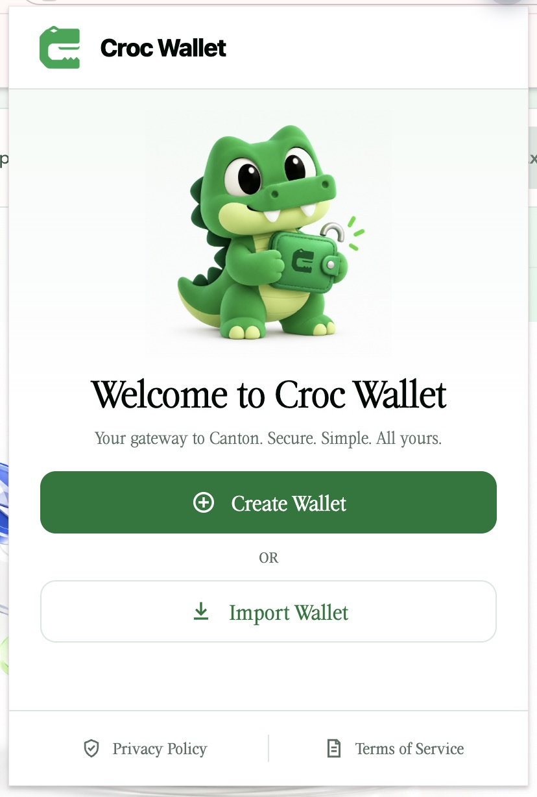

# Welcome to Croc Wallet

Croc Wallet is a self-custodial browser wallet for Canton Mainnet. It keeps wallet signing material inside the Extension while giving users a focused way to view assets, send and receive tokens, review Offers, and connect to Canton DApps.

*Captured from the installed Croc Wallet Extension without entering credentials or exposing an account.*

## What you can do

- Create a Canton wallet or import an existing one.
- View configured Canton Coin and Token Standard assets.
- Send assets after reviewing the destination, amount, and fee.
- Receive assets manually through Offers, or enable registrar-wide receive preapproval.
- Review transaction history and manage remembered accounts and contacts.
- Connect DApps without sharing your private key or recovery phrase.

## Start here

1. [Install the Extension](getting-started/install-extension.md).
2. [Create a Wallet](getting-started/create-wallet.md) or [Import a Wallet](getting-started/import-wallet.md).
3. [Back Up Your Recovery Phrase](getting-started/backup-recovery-phrase.md).
4. [Connect Croc Wallet](using-the-wallet/connect-apps.md).
5. [Receive Assets](using-the-wallet/receive-assets.md) and [Send Assets](using-the-wallet/send-assets.md).
6. Review [Wallet Security](permissions-and-security/wallet-security.md).

## Documentation version

This documentation targets Croc Wallet Extension **1.0.0** and `@croc-wallet/dapp-sdk` **1.0.0**. The SDK requires Extension 1.0.0 or newer. Screenshots show the installed Extension’s welcome and import entry screens. Account, balance, transfer and recovery-secret screens are described in text. The confirmation shown by your installed Extension is authoritative.

> Croc Wallet is self-custodial. Croc Wallet cannot recover a lost recovery phrase or private key.
