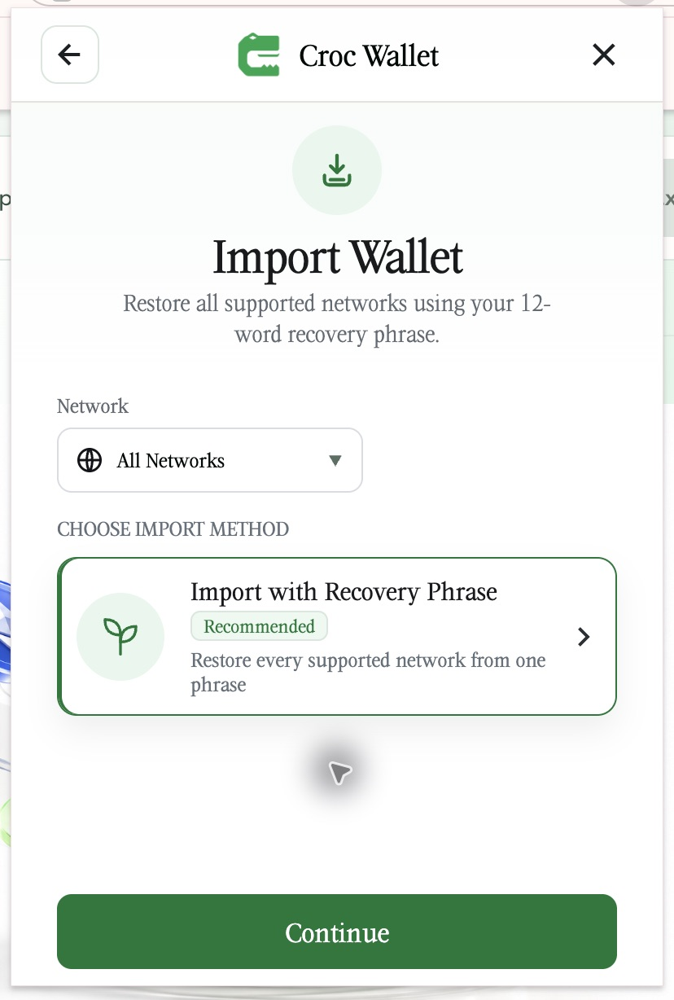
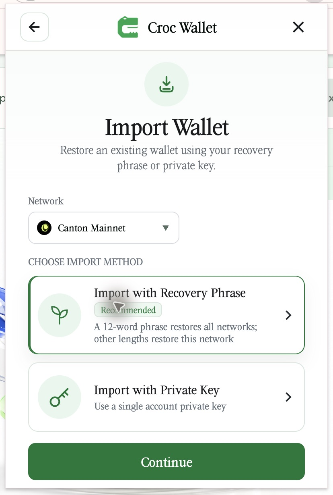

# Import a Wallet

Select **Import Wallet** in the Croc Wallet Extension, then choose the network and import method before entering recovery material.

**All Networks** uses a 12-word recovery phrase. To import a network-specific key, select **Canton Mainnet**, **EVM Networks**, or **Solana Mainnet** and use a method offered by that selection. A single-network private key does not recreate accounts on every network.

## Import your wallet

1. Open the Extension and select **Import Wallet**.
2. Select the network. Choose **All Networks** for a supported 12-word multichain recovery phrase.
3. Select **Import with Recovery Phrase** or, where offered, **Import with Private Key**.
4. Select **Continue**.
5. Enter the corresponding recovery phrase or private key only inside the Extension. Follow the word-count options shown for the selected network.
6. Set the required local password, review the recovery acknowledgment, and confirm only when ready.
7. Wait for account restoration and verify the selected account and network before use.

The current import entry screen does not ask for a Canton Party ID. The Canton restore flow can resolve an existing backend binding using the derived public key. Keep an independent record of the complete Party ID to verify the restored account; possessing a secret does not guarantee that every provider's account binding can be restored by this deployment.

Recovery-secret fields are deliberately not pictured in this guide. Never capture or publish a real recovery phrase or private key.

> **Security warning:** A website, support representative, or DApp must never request your recovery phrase or private key. Do not enter either secret outside the Croc Wallet Extension.

## If import does not complete

- **Invalid word count:** make sure the recovery phrase contains all 12 words, separated by spaces and in the original order.
- **Invalid key format:** copy the complete private key without extra spaces or missing characters.
- **Party or key mismatch:** stop and verify that the phrase or key belongs to the Canton party you expect. Never send the secret to another person for checking.

Next: [Home and Assets](../using-the-wallet/home-and-assets.md)
